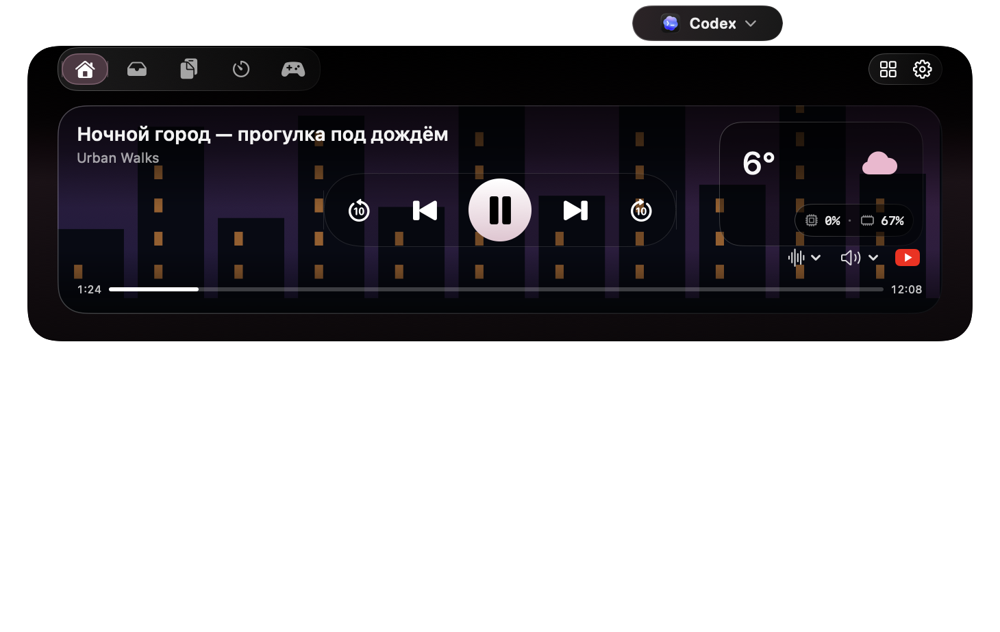
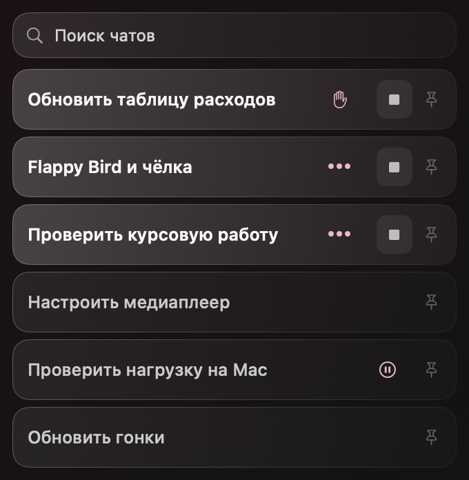

# FunNotch Sakura

A native macOS notch companion with a dark Sakura theme, a poster music player,
Codex chat controls, timers and games. This is a customised fork of
[JoshuaT1105/FunNotch](https://github.com/JoshuaT1105/FunNotch).





## Features

- The collapsed notch follows the physical camera cutout. Hover over the cutout
  to open a panel below the menu bar. Codex stays in a separate capsule on the right.
- Search and pin Codex chats, open a specific chat, stop a running answer, and see
  waiting, stopped and completed states when supplied by local lifecycle events.
  Multiple completions are queued rather than replacing each other.
- Full artwork music player with seek, transport controls, a selectable media
  source and pinned browser tabs. Controls follow the available source capabilities.
- Switch the macOS audio output between connected speakers, headphones and AirPods.
- Countdown, alarm sounds and scheduled shutdown.
- File shelf, clipboard history, compact weather and system metrics.
- Hellcat traffic game and Chess.com in a separate resizable WebKit window.

## Controls

- Hover over the physical cutout, or swipe down over it, to open.
- Swipe up to close. Swipe horizontally over the player to switch tracks.
- **Control–Option–C** opens the Codex chat list.
- Use the source menu in the player to choose an application or pin a browser tab.
- The speaker menu chooses the system audio output.

## Requirements and permissions

macOS 14 or newer, Apple silicon or Intel, and Xcode Command Line Tools to build.
The app also supports displays without a physical notch.

Browser control uses macOS Automation. Chrome-family browsers additionally need
“Allow JavaScript from Apple Events” in their Developer menu. Grant this only if
browser playback controls are wanted. Location is used for weather. Other optional
features request their relevant permissions when enabled.

Codex integration reads local thread metadata and lifecycle markers. Support for
waiting states depends on the events written by the installed Codex version.
No API key is required for this integration.

## Build

```sh
./build.sh
./build.sh --universal --package
```

The build script downloads Sparkle from its official release. Generated apps,
archives, profiles and personal settings are excluded from the repository.
The local Hellcat engine recording is licensed for use in finished media and is
excluded from this source repository. Add a suitably licensed recording as
`Assets/Audio/HellcatAcceleration.wav` to enable that acceleration voice.
Other game sound effects are generated in code. See the asset credits under `Assets`.

## Check

```sh
build/FunNotch.app/Contents/MacOS/FunNotch --self-test
build/FunNotch.app/Contents/MacOS/FunNotch --render-home-preview build/home-preview
swiftc Sources/Managers/CodexRunStateReader.swift Tools/CodexRunStateTests.swift -o build/codex-state-tests
build/codex-state-tests
```

## Releases and updates

This fork has its own configurable update channel. Builds with no channel configured
use manual updates. Configure the feed and the matching Sparkle public key at build time.
Keep the private signing key in the release maintainer's Keychain.

```sh
source ./release.env.example
./build.sh --universal --package
./Tools/make-appcast.sh dist/FunNotch-1.11.1.dmg
```

The current downloadable release targets Apple silicon and is ad-hoc signed; it
has not been notarised by Apple. Building locally is also supported.

The release workflow builds both architectures and runs the app self-test. Signing,
notarisation and signed update publication require the maintainer's credentials.

## Attribution and licence

Based on FunNotch by JoshuaT1105 and its contributors. Source is provided under
[GPL-3.0](LICENSE). Sakura photograph and the optional Hellcat recording have
separate attribution and terms in `Assets/Themes/SAKURA-CREDITS.md` and
`Assets/Audio/HELLCAT-CREDITS.md`.
